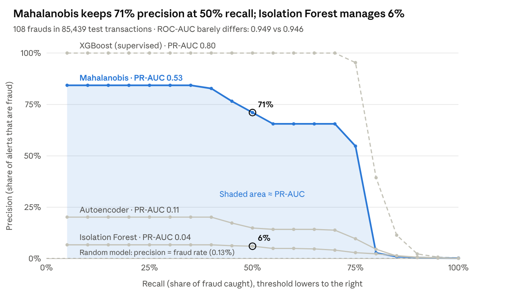

# PR-AUC Explained

Oct 9, 2026

## Precision and recall

PR-AUC summarizes how well a model ranks fraud above legitimate transactions, using only the two numbers fraud analysts care about: how much fraud gets caught, and how many alerts are real.

A fraud model outputs a score for each transaction. Choosing a threshold turns the scores into alerts, and every transaction then falls into one of four groups:

|  | Flagged | Not flagged |
| --- | --- | --- |
| **Fraud** | True positive (TP): fraud caught | False negative (FN): fraud missed |
| **Legitimate** | False positive (FP): false alarm | True negative (TN): correctly ignored |

- **Recall = TP / (TP + FN):** the share of all fraud that gets flagged.
- **Precision = TP / (TP + FP):** the share of flags that are actually fraud.

**Example from this project.** The Phase 3a test set has 85,439 transactions, of which 108 are fraud (0.13%). At the threshold used in the comparison table, Isolation Forest flags 12,512 transactions:

- 96 of them are fraud, so recall is 96 / 108 = **88.9%**.
- The other 12,416 are false alarms, so precision is 96 / 12,512 = **0.77%**.

The model catches most of the fraud, but analysts would have to review about 130 alerts to find each fraud case. Raising the threshold improves precision and lowers recall. PR-AUC measures that trade-off across every possible threshold, rather than at one.

## The precision-recall curve

Each threshold gives one precision-recall pair. Lowering the threshold traces out a curve, and PR-AUC is the area under that curve.



*Saved Phase 3a models (models/\*/2026-09-03) re-scored on the test split. Each point is the best precision reachable at that recall, in 5-point steps.*

Moving right along a curve means flagging more transactions: more fraud is caught, at the cost of more false alarms. Mahalanobis keeps 55–84% precision up to 75% recall and then drops sharply. XGBoost stays near 100% precision up to 75% recall. Isolation Forest never gets above 7% precision.

## How PR-AUC is calculated

This project calculates PR-AUC as **average precision**: a weighted average of precision, where each threshold's weight is the extra recall it adds. The function is sklearn's `average_precision_score`, called from `evaluate()` in `src/fraud_pipeline/models/evaluation.py`.

```math
\text{AP} = \sum_n (R_n - R_{n-1}) \, P_n
```

Here Pₙ and Rₙ are the precision and recall at the n-th threshold, with thresholds taken in order from the highest score down.

**A five-transaction example.** A model ranks five transactions from most to least suspicious: fraud, legitimate, fraud, legitimate, legitimate.

1. The threshold just below the 1st transaction flags 1 transaction, which is fraud. Precision is 1/1, and recall is 1/2 = 0.5.
2. The threshold just below the 3rd transaction flags 3, of which 2 are fraud. Precision is 2/3, and recall rises to 1.0.
3. AP = 0.5 × 1.0 + 0.5 × 0.667 = **0.83**.

The second fraud cost one false alarm to reach, and the score reflects that. If both frauds had been ranked first, AP would have been 1.0.

**What the scale means:**

- **1.0** means every fraud case is ranked above every legitimate transaction.
- **The fraud rate** is what a model that ranks at random scores. On this test set that is 0.0013, not 0.5 as it would be for ROC-AUC.
- **Values in between** read roughly as the average precision a reviewer sees while working down the list until all fraud is found.

sklearn's `auc(recall, precision)` gives a slightly different number, because it joins the points with straight lines and that can overstate performance. The stepwise sum above is the standard method, and it's the one this project uses.

## Why PR-AUC beats ROC-AUC for fraud

ROC-AUC measures false alarms as a share of all legitimate transactions. With 85,331 legitimate transactions in the test set, even hundreds of false alarms barely register, so ROC-AUC can't separate models whose alert queues are very different. Precision counts false alarms against the fraud actually caught, so PR-AUC shows the difference.

This project has a clear example. Isolation Forest and Mahalanobis have almost the same ROC-AUC, but very different PR-AUC:

| Model | ROC-AUC | PR-AUC | Best precision at 50% recall | False alarms to catch 54 of 108 frauds |
| --- | --- | --- | --- | --- |
| Mahalanobis | 0.949 | 0.53 | 71% | about 22 (0.03% of legitimate) |
| Isolation Forest | 0.946 | 0.04 | 6.0% | about 840 (1.0% of legitimate) |

To catch half the fraud, Isolation Forest produces about 38 times as many false alarms. Both rates are under 1% of legitimate transactions, so ROC-AUC differs by only 0.003. For an analyst, it's the difference between reviewing 76 alerts and about 900.

ROC-AUC is still useful for checking whether a model ranks well overall, and it doesn't change with the fraud rate. When fraud is rare and analyst review time is the limiting factor, PR-AUC is the better metric for choosing a model.

## Pitfalls when comparing PR-AUC

PR-AUC is only directly comparable between models scored on the same data with the same fraud rate. Even then, a single number hides where along the ranking a model is strong.

- **Different fraud rates.** A random model scores about the fraud rate, so the baseline moves with it. Phase 3b's windows are about 20% positive, against 0.13% in Phase 3a, so Phase 3b's 0.60 can't be compared directly with Phase 3a's 0.80. Compare each score with its own baseline instead. Phase 3b's labels also have a known data-capture problem.
- **Where the strength sits.** Mahalanobis's 0.53 comes almost entirely from the top of its ranking. Its precision is 84% at 10% recall but only 2.8% at 80% recall, close to Isolation Forest's 2.3%. If the business needs 80% recall, the two models are nearly equivalent there. Check precision at the recall level you plan to operate at, not just the overall area.
- **Few fraud cases.** With 108 frauds in the test set, a few cases moving up or down the ranking shifts PR-AUC noticeably. Report results across several seeds, or bootstrap confidence intervals, before trusting small differences.
- **Yes/no predictions.** The IQR baseline outputs flags, not scores, so its curve has only one threshold and its PR-AUC (0.0074) isn't comparable with the score-based models. Compare it at its single operating point instead.
- **Choosing on the test set.** Picking a model or setting because it maximizes test-set PR-AUC makes that number optimistic. Choose on a validation split and score the test set once, as set out in `docs/phase3-unsupervised-optimization.md`.
